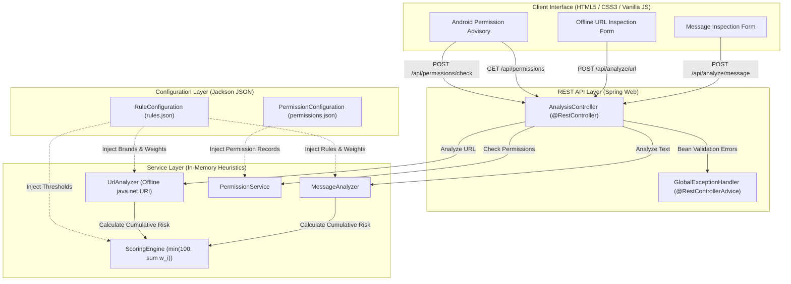
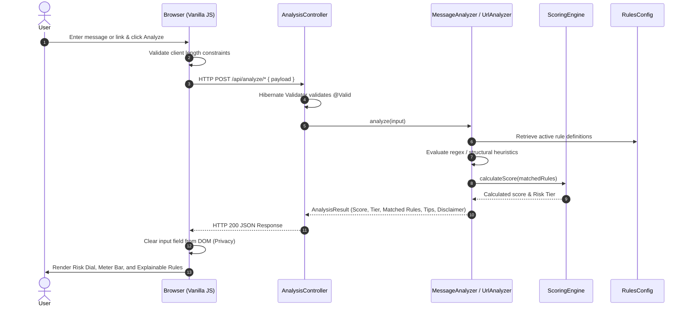

# System Architecture Documentation

## 1. Architectural Overview

The **Cybersecurity Awareness Platform** follows a layered, stateless Spring Boot 3 architecture designed around determinism, explainability, and strict user privacy.

---

## 2. Layered Responsibilities

### A. Presentation Layer (`src/main/resources/static/`)
- Pure client-side execution using HTML5, CSS3, and modern Vanilla JavaScript (`app.js`).
- Uses standard Fetch API to interact asynchronously with REST endpoints.
- **Privacy Enforcement:** Clears user inputs from the DOM immediately upon receiving analysis results.
- Uses safe DOM methods (`document.createElement`, `textContent`) to eliminate XSS risks.

### B. REST Controller Layer (`com.cybersecurity.controller`)
- Handled by `AnalysisController.java`.
- Accepts incoming JSON payloads mapped to validated DTOs (`MessageAnalysisRequest`, `UrlAnalysisRequest`, `PermissionRequest`).
- Validates constraints via Hibernate Validator (`@NotBlank`, `@Size`).
- Intercepts bad requests and malformed payloads through `GlobalExceptionHandler.java`, ensuring no stack traces or server internals leak to the client.

### C. Service Layer (`com.cybersecurity.service`)
- **`MessageAnalyzer`**: Regex and dictionary matching across 6 social engineering categories. Uses negative lookahead and benign exception contexts (e.g., legitimate bank warnings) to suppress false positives.
- **`UrlAnalyzer`**: Strictly local structural parsing using `java.net.URI` and string operations. Analyzes numeric IPs, typosquatting homoglyphs, brand subdomain masquerading, excessive hyphens, `@` symbols, and encoded paths.
- **`PermissionService`**: Catalogs 20 high-risk Android permissions. Maps requested permissions to explainable Allow, Deny, or Review guidance.
- **`ScoringEngine`**: Deterministic risk score aggregation:
  $$S = \min\left(100, \sum_{\text{unique } i} w_i\right)$$
  Maps aggregate scores to discrete categories: Low (`0 – 30`), Medium (`31 – 65`), High (`66 – 100`).

### D. Configuration Layer (`com.cybersecurity.config`)
- Loads and parses `rules.json` and `permissions.json` at startup via Jackson `ObjectMapper`.
- Validates JSON integrity during bean initialization (`@PostConstruct`).
- Enables updating detection heuristics without recompiling Java source code.

---

## 3. Data Flow & Execution Sequence

---

## 4. Architectural Invariants

1. **Zero Database / Zero File Persistence:** Submitted messages and links exist in JVM heap only during request processing and are garbage collected immediately.
2. **Offline URL Inspection:** The URL analyzer never initializes network sockets, DNS resolution, or HTTP connections.
3. **Purely Advisory Semantics:** All outputs are marked heuristic assessments; the platform never guarantees absolute malice or safety.
