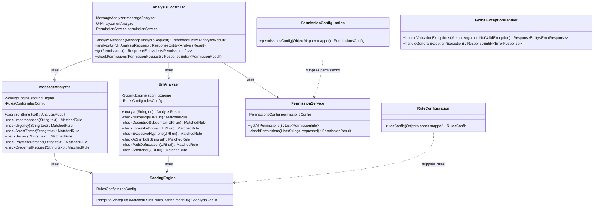
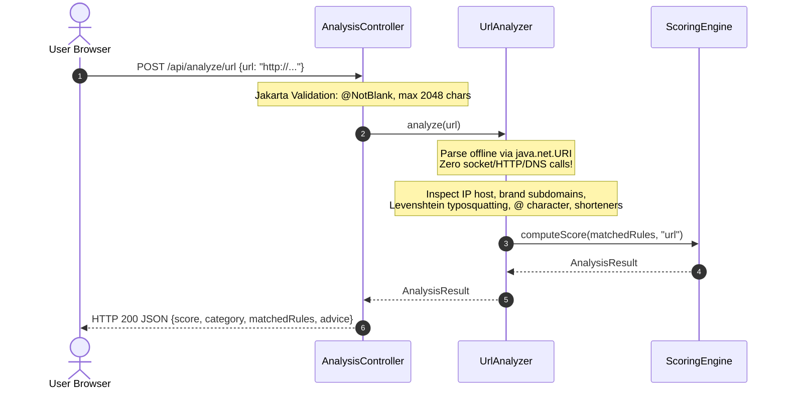
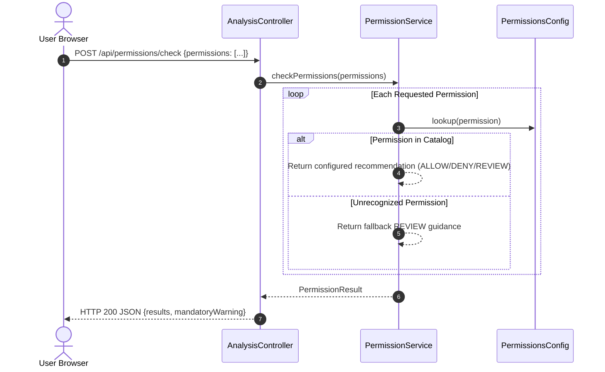

# System Architecture Documentation

**Application:** Cybersecurity Awareness Platform  
**Target Environment:** Java 17+, Spring Boot 3.3.5, Apache Maven, Fedora/Linux  
**Design Paradigm:** Layered Architecture, Inversion of Control, Offline-First Security  

---

## 1. Architectural Principles & High-Level Design

The Cybersecurity Awareness Platform adheres to four core engineering principles:

1. **Strict Layer Decoupling:** Complete separation of concerns between API exposure (`controller`), core evaluation logic (`service`), dynamic metadata (`config`), and transfer objects (`model`).
2. **Volatile In-Memory Processing:** Zero database or disk persistence for submitted messages or URLs to enforce strict user data privacy.
3. **Offline Structural Link Inspection:** Complete network isolation for URL evaluation—zero HTTP requests, zero socket connections, zero DNS queries.
4. **Configurable External Rules:** Decoupling detection weights, regex rules, brand dictionaries, and permission metadata into external JSON files loaded at application boot.

---

## 2. Component Class Diagram

The following Mermaid diagram accurately reflects the implemented class structure and dependency injection graph across the backend:



---

## 3. Layered Architecture Breakdown

```
+------------------------------------------------------------------------+
|                          PRESENTATION LAYER                            |
|          HTML5 Responsive Interface | CSS3 Dark Theme | Vanilla JS      |
+------------------------------------------------------------------------+
                                   | (JSON over HTTP Fetch API)
+------------------------------------------------------------------------+
|                          CONTROLLER LAYER                              |
|           AnalysisController | GlobalExceptionHandler | DTO Validation  |
+------------------------------------------------------------------------+
                                   | (In-Memory Method Invocations)
+------------------------------------------------------------------------+
|                           SERVICE LAYER                                |
|   MessageAnalyzer    |    UrlAnalyzer    |      PermissionService      |
|                      |                   |                             |
|          +-----------+-------------------+                             |
|          | Shared ScoringEngine (Aggregator & Classifier)              |
+------------------------------------------------------------------------+
                                   |
+------------------------------------------------------------------------+
|                     CONFIGURATION & DATA LAYER                         |
|   RuleConfiguration (rules.json)  | PermissionConfiguration (perms.json)|
+------------------------------------------------------------------------+
```

### A. Presentation Layer
- **Files:** [`index.html`](file:///home/d/study/sem3/oop-java/mini-project/src/main/resources/static/index.html), [`style.css`](file:///home/d/study/sem3/oop-java/mini-project/src/main/resources/static/css/style.css), [`app.js`](file:///home/d/study/sem3/oop-java/mini-project/src/main/resources/static/js/app.js)
- **Design:** Single-Page Application (SPA) hosted by Spring Boot static handler. Communicates with backend endpoints via the native browser `fetch()` API.
- **Security:** Zero client-side storage (`localStorage`/`sessionStorage`/`cookies`). All dynamic UI rendering uses `document.createElement()` and `textContent` to prevent DOM XSS vulnerabilities.

### B. Controller Layer
- **Class:** [`AnalysisController.java`](file:///home/d/study/sem3/oop-java/mini-project/src/main/java/com/cybersecurity/controller/AnalysisController.java)
- **Endpoints:**
  - `POST /api/analyze/message` — Analyzes text for social engineering and scam patterns.
  - `POST /api/analyze/url` — Analyzes link structure for obfuscation and phishing indicators.
  - `GET /api/permissions` — Returns full catalog of 20 high-risk Android permissions.
  - `POST /api/permissions/check` — Evaluates a selected list of Android permissions.
- **Validation:** Utilizes Jakarta Validation annotations (`@NotBlank`, `@Size(max = 10000)`, `@Size(max = 2048)`).

### C. Service Layer & Scoring Engine
- **Class:** [`MessageAnalyzer.java`](file:///home/d/study/sem3/oop-java/mini-project/src/main/java/com/cybersecurity/service/MessageAnalyzer.java)
  - Evaluates message strings across six categories: Authority Impersonation, Urgency/Fear, Digital Arrest Threats, Secrecy/Isolation, Payment Demands, and Credential Requests.
  - Implements negative context filtering to avoid false positives on legitimate security advisories.
- **Class:** [`UrlAnalyzer.java`](file:///home/d/study/sem3/oop-java/mini-project/src/main/java/com/cybersecurity/service/UrlAnalyzer.java)
  - Uses `java.net.URI` to parse URL authority, host, user-info, path, and query components strictly offline.
  - Detects raw IP hosts, deceptive brand subdomains, typosquatting domains (Levenshtein distance $\le 1$ token substitution), excessive hyphens ($\ge 3$), embedded authority `@`, long/encoded paths, and known URL shorteners.
- **Class:** [`PermissionService.java`](file:///home/d/study/sem3/oop-java/mini-project/src/main/java/com/cybersecurity/service/PermissionService.java)
  - Matches requested Android permissions against [`permissions.json`](file:///home/d/study/sem3/oop-java/mini-project/src/main/resources/permissions.json). Unrecognized permissions fall back to a safe default `REVIEW` advisory.
- **Class:** [`ScoringEngine.java`](file:///home/d/study/sem3/oop-java/mini-project/src/main/java/com/cybersecurity/service/ScoringEngine.java)
  - Shared scoring component that aggregates unique rule weights:
    $$S = \min\left(100, \sum_{i \in \text{Unique Matched Rules}} w_i\right)$$
  - Classifies aggregate risk into standardized tiers:
    - **Low Risk:** $0 \le S \le 30$
    - **Medium Risk:** $31 \le S \le 65$
    - **High Risk:** $66 \le S \le 100$

### D. Configuration Layer
- **Classes:** [`RuleConfiguration.java`](file:///home/d/study/sem3/oop-java/mini-project/src/main/java/com/cybersecurity/config/RuleConfiguration.java), [`PermissionConfiguration.java`](file:///home/d/study/sem3/oop-java/mini-project/src/main/java/com/cybersecurity/config/PermissionConfiguration.java)
- Reads [`rules.json`](file:///home/d/study/sem3/oop-java/mini-project/src/main/resources/rules.json) and [`permissions.json`](file:///home/d/study/sem3/oop-java/mini-project/src/main/resources/permissions.json) via Jackson `ObjectMapper` at startup.

### E. Exception Handling
- **Class:** [`GlobalExceptionHandler.java`](file:///home/d/study/sem3/oop-java/mini-project/src/main/java/com/cybersecurity/exception/GlobalExceptionHandler.java)
- Annotated with `@RestControllerAdvice`. Catches `MethodArgumentNotValidException`, `HttpMessageNotReadableException`, and general exceptions, returning clean [`ErrorResponse`](file:///home/d/study/sem3/oop-java/mini-project/src/main/java/com/cybersecurity/model/ErrorResponse.java) JSON payloads with appropriate HTTP status codes (400, 500).

---

## 4. Execution Flow Sequence Diagrams

### A. Message Analysis Execution Flow

```mermaid
sequenceDiagram
    autonumber
    actor User as User Browser
    participant Controller as AnalysisController
    participant Analyzer as MessageAnalyzer
    participant Engine as ScoringEngine
    participant Config as RulesConfig

    User->>Controller: POST /api/analyze/message {text: "..."}
    Note over Controller: Jakarta Validation: @NotBlank, max 10000 chars
    Controller->>Analyzer: analyze(text)
    Analyzer->>Config: getMessageRules()
    Note over Analyzer: Execute regex & keyword rules with negative context filtering
    Analyzer->>Engine: computeScore(matchedRules, "message")
    Note over Engine: Deduplicate rule IDs<br/>Sum weights: S = min(100, sum w_i)<br/>Classify: Low / Medium / High
    Engine-->>Analyzer: AnalysisResult
    Analyzer-->>Controller: AnalysisResult
    Controller-->>User: HTTP 200 JSON {score, category, matchedRules, advice}
    Note over User: Input cleared from DOM; Result rendered via textContent
```

### B. URL Inspection Execution Flow (Offline-Only)



### C. Android Permission Guidance Flow


